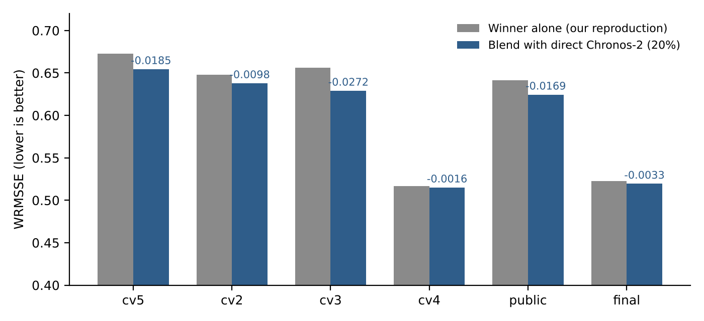
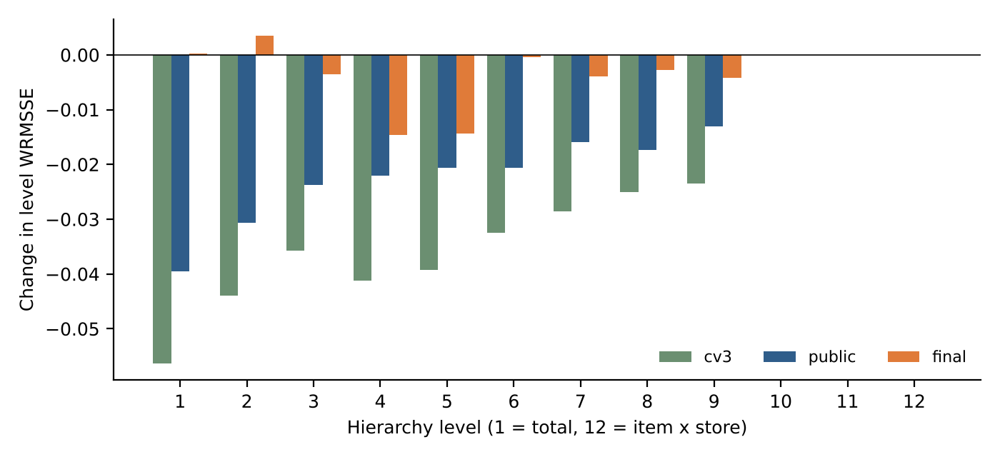
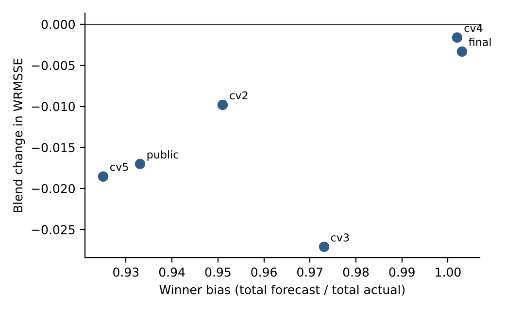
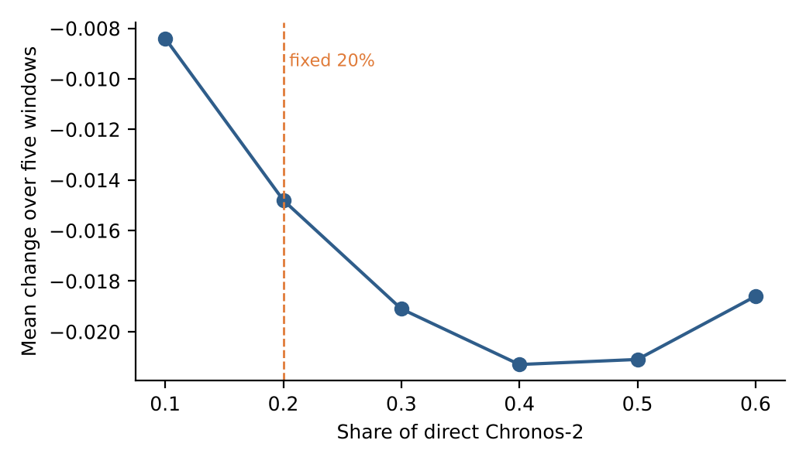
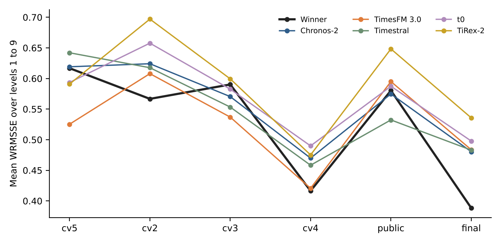
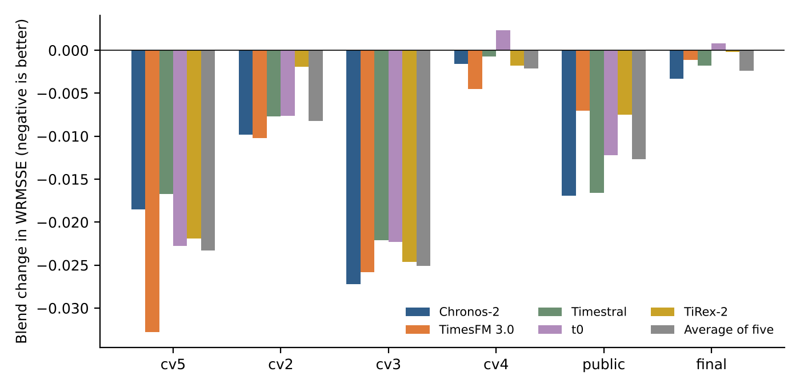

# M5 hierarchical retail forecasting: blending the winner's LightGBM with zero-shot foundation models

**Full project report: code, data, methods, every result, interpretations and the reasons behind each decision**

| | |
|---|---|
| Student | Alif Bagas Adiutomo, Department of Industrial Engineering and Management, Yuan Ze University |
| Advisor | Dr. Yogi Tri Prasetyo |
| Report date | 24 October 2026 (deadline about 29 October 2026) |
| Repository | `m5-foundation-blend` (this report is `docs/REPORT.md`; the PDF with all code and raw results is `docs/REPORT_FULL_with_code_and_results.pdf`) |
| Status | Main experiments finished and checked. One overnight job on PC 2 (tuned shares, top-down alignment, new Chronos-2 variants) was launched on 21 October; its result files had not come back when this report was written, so they are described but not reported (Section 9). |

## 0. The result in one paragraph

We rebuilt the winning M5 solution (six LightGBM model sets, averaged) on six forecast windows. We then replaced 20 percent of its forecast at the nine aggregate levels of the hierarchy with a zero-shot Chronos-2 forecast made directly on the summed series. The rule was fixed before the final window was scored. The blend scored better than the winner alone on all six windows, with a mean gain of 0.0129 WRMSSE (95 percent interval 0.0072 to 0.0182, sign test p = 0.031). On the competition's final window it moves our reproduction from 0.5228 to 0.5195, which is below the official winning score of 0.5204. That last gap is smaller than the noise in the test, so the safe claim is that the blend beats **our reproduction** consistently, and matches or slightly improves on the official winner. **We cannot say that we beat the winner with statistical confidence, and this report never claims it.**

### How to read this report

Sections 1 to 4 explain the problem, the data, the score and the machines. Section 5 tells the story of the project in order and gives the reason for every decision. Section 6 explains each method. Section 7 gives every result with an interpretation. Section 8 states what is and is not proven. Section 9 lists limits, ideas that were considered, and work still open. Section 10 lists the literature we checked. Section 11 explains how to rerun everything from this repository. The appendices hold level-by-level tables, a file inventory, a glossary and our working rules. In the PDF version, the full source code and every raw result file follow as further appendices.

Every number comes from a saved result file in `results/`. Where a number comes from an estimate or from a log line rather than a file, the text says so.

## 1. Project goal and targets

The M5 Accuracy competition (Walmart sales, run on Kaggle in 2020) asked for 28-day sales forecasts for 42,840 related time series. Gradient-boosted trees did best, and the first-place solution by YeonJun In used LightGBM ([Makridakis, Spiliotis and Assimakopoulos, 2022b](https://ideas.repec.org/a/eee/intfor/v38y2022i4p1346-1364.html); [Januschowski et al., 2022](https://ideas.repec.org/a/eee/intfor/v38y2022i4p1473-1481.html)). Since then, pretrained time series foundation models have appeared that forecast new data with no training on it ([Ansari et al., 2024](https://mlanthology.org/tmlr/2024/ansari2024tmlr-chronos); [Das et al., 2024](https://proceedings.mlr.press/v235/das24c.html); [Ansari et al., 2025](https://arxiv.org/abs/2510.15821v1)). A 2025 workshop preprint by Yang, Cao and Liu ([arXiv 2507.22053](https://arxiv.org/abs/2507.22053), not peer reviewed) reports that an ensemble of LightGBM and PatchTST reaches 0.4989 on the M5 task, against 0.5230 for their LightGBM reference.

The research question is: **can newer models, especially pretrained foundation models used zero-shot, improve on the M5 winner without retraining the winner?**

Three targets were agreed, in this order of priority:

| Target | WRMSSE | Meaning |
|---|---|---|
| Official winner | 0.5204 | The published winning score on the final window. Primary target. |
| Our reproduction | 0.5228 | The winner's own code run by us under the same protocol. The fair comparison: a blend must beat this, because it removes machine and library differences. |
| Stretch (Yang et al.) | 0.4989 | A preprint result. Stretch goal only, since it is not peer reviewed and its protocol may differ. |

**Why the reproduction differs from the official score.** The official 0.5204 comes from the competition run. Our run uses the same code and settings but a different machine, library versions and compatibility patches, so a gap of 0.0024 is expected. When we compare a blend to a winner, the fair comparison is always winner (our run) against blend (built on the same winner run).

## 2. The M5 data and how it is organised

The organiser's release has four tables. We used the full release, which includes the evaluation days that Kaggle hid at the time.

| File | Rows | What it holds |
|---|---|---|
| `sales_train_evaluation.csv` | 30,490 (one per item in one store) | Identifier columns (id, item_id, dept_id, cat_id, store_id, state_id) and daily unit sales in columns d_1 to d_1941. |
| `sales_test_evaluation.csv` | 30,490 | The 28 final days d_1942 to d_1969. Appending these gives 1,969 days. Final-window scoring needs this file. |
| `calendar.csv` | 1,969 days | Date, weekday, month, year, week id (`wm_yr_wk`), up to two event names and types per day, and SNAP flags for CA, TX and WI (days when food-stamp purchases are allowed). |
| `sell_prices.csv` | about 6.8 million | Weekly price of each item in each store. A missing price means the item was not on sale that week. |

The data are not included in this repository (see `data/README.md`).

### The hierarchy

Sales are nested: an item sold in a store belongs to a department, a category, a state, and the whole company. M5 scores forecasts at twelve levels at once. The 30,490 item-store series are the bottom level (level 12). Every other level is a sum of bottom series.

| Level | Name | Series | Made by summing |
|---|---|---|---|
| 1 | Total | 1 | All series |
| 2 | State | 3 | Stores in a state (CA, TX, WI) |
| 3 | Store | 10 | Each of 10 stores |
| 4 | Category | 3 | Each category (FOODS, HOBBIES, HOUSEHOLD) |
| 5 | Department | 7 | Each of 7 departments |
| 6 | State x Category | 9 | State by category |
| 7 | State x Department | 21 | State by department |
| 8 | Store x Category | 30 | Store by category |
| 9 | Store x Department | 70 | Store by department |
| 10 | Item | 3,049 | One item across all stores |
| 11 | Item x State | 9,147 | One item across a state |
| 12 | Item x Store | 30,490 | The raw bottom series |

Total: 1 + 3 + 10 + 3 + 7 + 9 + 21 + 30 + 70 + 3,049 + 9,147 + 30,490 = 42,840 series.

**Why this matters for the method.** The top levels (1 to 9, only 154 series) are smooth, high-volume series. The bottom levels (10 to 12) are noisy and often zero. A model that works well at the top may do nothing at the bottom, and the score weights every level equally, so the bottom three levels, which are the hardest, make up a quarter of the score. In the final window the winner scores 0.20 to 0.57 at levels 1 to 9 and 0.88 to 0.97 at levels 10 to 12.

### Time axis and the six windows

The data covers d_1 to d_1969. A forecast window is 28 days long. A model sees only days up to its origin and forecasts the next 28 days. The first four origins (cv5, cv2, cv3, cv4) are validation folds that the winner's own code defines, and the last two are the competition's public and final windows, so each window is exactly what the winner's code produces when trained up to that day.

| Window | Trained on days up to | Forecast days | Role |
|---|---|---|---|
| cv5 | d_1801 | d_1802 to d_1829 | Extra evidence window |
| cv2 | d_1829 | d_1830 to d_1857 | Extra evidence window |
| cv3 | d_1857 | d_1858 to d_1885 | Extra evidence window |
| cv4 | d_1885 | d_1886 to d_1913 | Validation fold used earlier for design checks |
| public | d_1913 | d_1914 to d_1941 | The competition's public leaderboard window |
| final | d_1941 | d_1942 to d_1969 | The competition's final (private) window. Scored only after the rule was fixed. |

The windows do not overlap in their forecast days, but each one trains on mostly the same history, so they are not fully independent. We say this wherever we count windows.

## 3. The score (WRMSSE) and how we checked our scorer

**What the score measures.** WRMSSE is the weighted root mean squared scaled error. For each of the 42,840 series the squared forecast error over the 28 days is divided by the series' typical day-to-day change in training (its scale, computed from the first non-zero sale onward), and its square root gives the RMSSE. Each series gets a weight equal to its share of dollar sales (units times price) in the last 28 training days, and weights add to one inside each level. A level's score is the weighted sum of its RMSSE values. The overall score is the plain average of the twelve level scores. Lower is better. A score near 1 is about as good as a simple naive forecast.

**Why scale and weights matter.** Dividing by each series' own scale puts slow and fast sellers on one footing, and weighting by dollars puts the focus on products that earn money. Because every level counts equally, the item-level scores (levels 10 to 12), which are hard and large, weigh as much as the total (level 1), which is easy.

**Checking our scorer.** We wrote our own evaluator (`src/m5_data_and_wrmsse.py`). On the final window the seasonal naive baseline (repeat the last week) scores 0.8470, matching the official value at all twelve levels. Our scorer also reproduces the winner's 0.5228 exactly from the saved forecast file, and the public-window figure 0.6415. Sanity checks built into the script (weights sum to one at each level, a perfect forecast scores zero, 42,840 series across 12 levels) all pass.

## 4. Machines, folders and workflow

Three computers shared the work. The cloud workspace had no GPU and could not hold the 1,969-day file for the final window, so final-window scoring and every heavy run happened on the user's machines. Files moved by zip.

| Machine | Hardware | Used for |
|---|---|---|
| PC 1 | Holds the original data and early LightGBM results | Data preparation and the first experiments |
| PC 2 | NVIDIA RTX 3090 GPU, Python virtual environment | Chronos-2 and the other foundation models, PatchTST, final-window scoring, bootstrap analysis |
| PC 3 | Intel i7-13700, 24 threads, 32 GB RAM, CPU only | Training the winner's LightGBM models (about 11 hours per window, 220 model files each) and SHAP |

**Workflow rules we kept.** Each job was a single script with plain-text output. Rules for every job: do not delete files, do not change model settings, do not send anything anywhere, copy results back under new names. Heavy runs ran outside OneDrive. Experiments on the winner's code kept its settings unchanged; only compatibility patches (library versions, the window key) were applied and logged in the patch logs in `results/02_winner_reproduction/`.

**Compute spent.** Winner training: the final window, the public window and cv4 first, then cv3, cv2 and cv5, about 11.0, 11.0 and 10.8 hours on PC 3 respectively. Foundation-model runs take under two minutes per window each on the GPU for the 154 aggregate series.


## 5. The project in order, and why each decision was made

This section is the logic of the project. For each step it says what we did, what came out, and why the next step followed. Numbers in this section are from the result files named in each step.

### 5.1 Step 1: get the scorer right (before any model)

**What.** We wrote the 12-level WRMSSE evaluator and tested it on synthetic data and on the real data with the naive and seasonal naive baselines (`results/01_baselines_and_early_models/results_phase1_baselines.txt`). On the public window the naive forecast scores 1.4639 and the seasonal naive 0.8697. On the final window the seasonal naive scores 0.8470, which matches the official value at every level.

**Why.** Every later comparison is only as good as the scorer. If the scorer were wrong by a small amount, a blend that "beats" the winner could be a scoring artefact. Matching a published benchmark to four digits at all twelve levels removes that doubt.

### 5.2 Step 2: our own LightGBM, to learn what matters (E1 and E1b)

**What.** We trained a single global LightGBM model (Tweedie loss) on weekly forecast origins and added feature groups one at a time. On the public window (`results_E1_lightgbm.txt`, `results_E1b_lightgbm.txt`):

| Step | Features | WRMSSE | Change |
|---|---|---|---|
| L0 base (lags, rolling means, calendar) | 34 | 0.6141 | |
| L1 + price | 38 | 0.5779 | -0.0362 |
| L2 + event | 43 | 0.5597 | -0.0183 |
| L3 + context (group level averages) | 49 | 0.5422 | -0.0174 |
| L4 + sample weights | 49 | 0.5888 | +0.0465 |

Seasonal naive on the same window scored 0.8697. Price, events and group context each helped; sample weights hurt. **L4 was declared the final model in advance (0.5888). L0 to L3 are ablation rows scored on the holdout for information only, so 0.5422 must not be quoted as a result.** Gain was dominated by the 28-day mean features (68 percent of gain at L0; the non-zero mean at 51 percent in L4).

**Why we did it.** It told us which kinds of information help a tree model on this data, and it gave a first working reference before we spent days of compute on the winner's code. **Why we did not stop here.** Our own model is not the competition winner, and the goal is to improve on the winner. A claim that a foundation model helps *our* LightGBM would not say anything about the M5 winner. So the comparison had to be against the winner's own code.

### 5.3 Step 3: zero-shot foundation models alone (Chronos-2, PatchTST)

**What.** We forecast every one of the 30,490 bottom series with Chronos-2 (zero-shot) in three variants and trained PatchTST on M5. On the public window (`results_chronos2_public_window.txt`, `results_patchtst_public_window.txt`):

| Model | WRMSSE | Reading |
|---|---|---|
| Seasonal naive | 0.8697 | Baseline |
| Chronos-2 A, history only | 0.7501 | Zero-shot, no covariates |
| Chronos-2 B, with covariates | 0.6991 | Covariates (weekday, event, SNAP, price) help by 0.051 |
| Chronos-2 C, cross-learning (best grouping: item) | 0.7046 | Related series forecast together; no gain over B |
| PatchTST P0, history only | 0.8962 | Trained on M5; worse than seasonal naive |
| PatchTST P1, with covariates | 0.7460 | Covariates help by 0.15 |

On the final window, bottom-up Chronos-2 scored 0.6320 and PatchTST with covariates 0.6613 (`results_*_final_window.txt`), against 0.5228 for the winner.

**Why.** We needed to know whether foundation models can compete on their own. They cannot: even the best is far behind a tuned tree ensemble, in line with the M5 conclusions. It also showed that covariates are the main driver for both model types, which is why every later foundation-model run uses covariates.

### 5.4 Step 4: the key observation, direct aggregates instead of bottom-up sums

**What.** Looking at the levels, bottom-up Chronos-2 was weak at the top of the hierarchy (level 1 about 0.37 against 0.20 for the winner). The reason is that item-level errors are large and do not cancel when added up. We therefore forecast the **summed series directly**: the 154 aggregate series of levels 1 to 9, each given to Chronos-2 with its own covariates. Results over levels 1 to 9 on the final window (`results/03_chronos2_aggregate/results_aggregate.txt`, mean over the nine levels): winner 0.388, direct Chronos-2 B 0.480, bottom-up Chronos-2 0.525, bottom-up PatchTST 0.564.

**Why.** At the top of the hierarchy the series are smooth and high-volume, which is where a pretrained model is at its best. Forecasting there closes about half of the gap. Direct B (with covariates) was best in the three early windows; direct A (no covariates) was worse, and the bottom-up versions swung widely between windows. A stable candidate was what we needed for a blend.

### 5.5 Step 5: rebuild the winner (the hard part, 11 hours per window)

**What.** We ran the M5 first-place code (folder A1 of the M5 methods repository) on PC 3, first for the final window, the public window and cv4, later for cv3, cv2 and cv5. Only compatibility patches were applied (library versions, window selection), all listed in `PATCH_LOG_*.txt`. The result was 0.5228 on the final window against 0.5204 official.

**Why.** Three reasons. First, the question is about improving the winner, so we need the winner's forecasts. Second, using the winner's own code under the same protocol is the fair baseline: a blend must beat *this* run. Third, running six windows, not one, is what allows an honest statement about consistency (Section 7.3). One window can be luck. Four extra windows cost about 33 hours of compute and turned a one-window anecdote into a six-window test.

### 5.6 Step 6: fix the blend rule before looking at the final window

**What.** We named the headline rule in advance: 20 percent of direct Chronos-2 B (mean point forecast, covariates, context 1,024) mixed into the winner at levels 1 to 9; levels 10 to 12 stay as the winner forecast them.

**Why each part of the rule.**

- *Direct forecasts.* From step 4: stable at the top of the hierarchy.
- *Levels 1 to 9 only.* The foundation model's level scores at the item levels were no better than the winner's (Section 7.8), and the aggregates are where the winner's bias shows (Section 7.5).
- *Share 0.20.* A modest round value. A foundation model that is weaker alone should get a minority share. It was fixed before the final window and never tuned on it. Other shares are reported only as sensitivity (Section 7.6).
- *Covariates, mean point forecast.* Covariates matter (Section 5.3). WRMSSE is a squared-error measure, so the mean minimises it; the median is reported and is nearly the same.
- *Context 1,024 days.* Long enough to cover about three years of seasonality, short enough to stay cheap. Fixed, never changed between windows.
- *Pre-declaration.* More variants raise the chance of a lucky win. Naming the rule first is what makes the result honest.

### 5.7 Step 7: test the rule, then try to break it

We scored all six windows (Section 7.3), tested the final window against the official number with a bootstrap (7.4), explained where the gain comes from (7.5), and then ran extra checks: ablations (7.6), a share sweep (7.6), reconciliation (7.7), item-level forecasts at levels 10 and 11 (7.8), four other foundation models (7.9) and SHAP on the winner (7.10). **Why:** a single positive result invites the questions "is it just Chronos-2?", "is it just this window?", "does it depend on the share?", "is it explained by anything?". Each extra run answers one of those.

### 5.8 Decision log (summary)

| Decision | Alternative | Reason |
|---|---|---|
| Score with our own evaluator, checked against the official seasonal naive | Trust a library | Every result depends on it; matching 0.8470 at 12 levels removes doubt |
| Compare against the reproduced winner, not only the official number | Compare only to 0.5204 | Removes machine and library differences from the comparison |
| Six windows | Final window only | One window cannot show consistency; the winner's bias changes from window to window |
| Direct forecasts of aggregates | Bottom-up sums | Item errors do not cancel; bottom-up was unstable across windows |
| Covariates on | Univariate | Gained 0.05 (Chronos-2) and 0.15 (PatchTST) on the public window |
| Mean point forecast | Median | Squared-error metric; the median result is nearly the same |
| Levels 1 to 9 only | All levels | No evidence of gain at item levels in the first design; see 7.8 for the later test |
| Fixed 20 percent share | Tuned share | Tuning on the test window would make the result untrustworthy |
| Chronos-2 as headline | TimesFM 3.0 (best mean later) | Chronos-2 was named in advance; choosing after the results would be selection |
| Report the final window once | Iterate on it | The final window is the only unseen check |
| Do not claim to beat the winner | Claim | The margin is inside the bootstrap noise |

## 6. Methods in detail

### 6.1 The winner: six LightGBM sets

The M5 winner trained gradient-boosted trees (LightGBM) with a Tweedie loss, which suits sales data with many zeros and a skewed shape. It made six model sets, each a collection of separate models by group, then averaged them with equal weights.

- **nr_*** = non-recursive. One model predicts each of the 28 days directly. Features use only sales at least 28 days old, so no forecast is fed back in.
- **r_*** = recursive. Models that use recent days and feed their own forecasts forward day by day.
- **store, store_cat, store_dept** = the grouping: separate models per store (10), per store and category (30), or per store and department (70). Each family has 220 models in total.

Features include lags, rolling means and standard deviations over several windows (7, 14, 30, 60, 180 days), target encodings (average sales by item, state, store and similar groups, rebuilt using only days before the forecast origin), price and price momentum, calendar fields, events and SNAP flags. Each model uses 3,000 trees. We changed no setting. For every new window the script rebuilds target encodings on days up to the origin and retrains all six sets, which is why each window costs about 11 hours.

**Why six sets and equal weights (the winner's design).** The sets make different kinds of errors. Recursive sets are less biased when sales are rising; non-recursive ones are stable but under-forecast when sales jump. Averaging cancels part of this, but it also explains why the winner's bias varies so much between windows (Section 7.5).

### 6.2 Foundation models, zero-shot

A foundation model is a large model pretrained on many time series from many fields. **Zero-shot** means we do not train it on M5: we hand it a history and it returns a forecast. This is cheap, has no tuning, and is easy to explain. The main model is **Chronos-2** (Amazon, `amazon/chronos-2`), which can also use covariates (extra series known in advance).

For the aggregate series, the covariates are built per group: the weekday of each day, whether an event occurs, and the SNAP flag averaged over the group's states (a group in one state gets that state's flag; the total gets the weighted mix). Settings fixed in advance: context 1,024 days, horizon 28, point forecast equal to the mean implied by the model's quantiles (the integral of the quantile function), clipped at zero.

**PatchTST** cuts the history into patches (length 16, stride 8) and predicts all 28 days at once ([Nie et al., 2023, preprint](https://arxiv.org/abs/2211.14730)). We trained one global model on M5 with and without covariates (context 224 days, level scaling, masked loss, 12,000 steps, fixed settings, seed 0). It appears only as a comparison member.

### 6.3 The blend

For each of the nine aggregate levels the blended forecast of every series is

**blend = 0.80 × winner aggregate + 0.20 × direct Chronos-2 B forecast**

where the winner aggregate is the winner's 30,490 bottom forecasts summed up to that level. Levels 10, 11 and 12 stay as the winner forecast them.

**An important consequence.** Each level is blended on its own, so the blended levels no longer add up exactly (the state forecasts do not sum to the total, for example). This is called incoherence. We handle it two ways: we state it as a limitation, and we ran an OLS reconciliation (6.5) that makes all twelve levels add up, as a labelled secondary result.

### 6.4 How we judged results: uncertainty and honesty rules

- **Day-block bootstrap.** We resample the 28 forecast days in blocks of 7 days (to keep weekly patterns), 4 blocks per draw, 2,000 draws, and recompute the whole 12-level score each time. This gives a 95 percent interval for the change in WRMSSE and the share of draws where the blend is better. It captures day-to-day luck only, not which series or which model, so it is a rough guide. The same draws are used for every variant.
- **Across-window checks.** We count windows improved, run a two-sided exact sign test (6 of 6 gives p = 0.031; 5 of 6 would give 0.22), and bootstrap the mean change.
- **Pre-declaration.** The headline blend was named before the final window was scored. Everything else is labelled secondary or sensitivity.
- **Reporting all variants.** More variants raise the chance of a lucky win, so the report states how many were tried (Section 9).

### 6.5 Reconciliation (secondary)

Reconciliation adjusts the forecasts of all levels as little as possible (in the ordinary least squares sense, [Hyndman et al., 2011](https://research.monash.edu/en/publications/optimal-combination-forecasts-for-hierarchical-time-series/)) so they add up; [Athanasopoulos et al. (2024)](https://ideas.repec.org/a/eee/intfor/v40y2024i2p430-456.html) review the field. We solved it without building the huge matrix, using a conjugate-gradient solver on the stacked aggregation matrices (solver residual about 1e-9 on every window, which confirms the solution is accurate). A structural variant was tried on two windows and was worse (`results/07_reconciliation`).

### 6.6 Other foundation models (replication)

To test that the gain is not specific to Chronos-2 we ran four more zero-shot models with the same inputs, rule and windows: **t0-gamma** (The Forecasting Company), **Timestral-209M** (Mistral), **TimesFM 3.0** (Google; weights carry a non-commercial licence, fine for a thesis; see also [Das et al., 2024](https://proceedings.mlr.press/v235/das24c.html)) and **TiRex-2** (NXAI, the decontaminated variant released for zero-shot benchmark evaluation). Each ran in its own Python environment with the same covariates, context 1,024 and horizon 28, and was scored standalone and as a 20 percent blend. An extra row averages all five models.

### 6.7 SHAP explainability

To explain why the winner behaves as it does, we computed exact SHAP values ([Lundberg et al., arXiv 1905.04610](https://arxiv.org/abs/1905.04610)) for the winner's nr_store models in three stores (CA_1, TX_1, WI_1), sampling 4,000 rows each from the final window. The script reuses the winner's own feature code and does not retrain anything. Values are on the log scale of the Tweedie forecast.


## 7. Results

All scores are WRMSSE (lower is better). "Change" is blend minus winner, so negative means the blend is better.

### 7.1 Reproduction of the winner

On the final window our run gives 0.5228 against the official 0.5204. The individual sets differ widely, and averaging them is what produces a good score. The table lists each set with its bias (total forecast divided by total actual; 1.000 is unbiased). Source: `results/02_winner_reproduction/`.

| Set | Final WRMSSE | Final bias | Public WRMSSE | Public bias | cv3 WRMSSE | cv3 bias | cv5 WRMSSE | cv5 bias |
|---|---|---|---|---|---|---|---|---|
| nr_store | 0.5282 | 0.987 | 0.6950 | 0.920 | 0.7297 | 0.942 | 0.8232 | 0.884 |
| nr_store_cat | 0.5535 | 0.973 | 0.7678 | 0.905 | 0.7735 | 0.924 | 0.9155 | 0.862 |
| nr_store_dept | 0.6064 | 0.952 | 0.8629 | 0.883 | 0.8511 | 0.901 | 0.9757 | 0.848 |
| r_store | 0.6835 | 1.066 | 0.4734 | 0.987 | 0.6955 | 1.050 | 0.5451 | 1.030 |
| r_store_cat | 0.5802 | 1.029 | 0.5440 | 0.963 | 0.6629 | 1.022 | 0.5650 | 0.975 |
| r_store_dept | 0.5526 | 1.011 | 0.6184 | 0.942 | 0.6578 | 0.997 | 0.6142 | 0.952 |
| **average** | **0.5228** | **1.003** | **0.6415** | **0.933** | **0.6562** | **0.973** | **0.6730** | **0.925** |

**Interpretation.** The ranking of the sets flips between windows. On the final window the non-recursive sets are best; on the public window the recursive ones are far better (r_store 0.4734 against nr_store 0.6950). This window sensitivity is itself a finding: tuning anything on a single window would mislead. The winner's score also varies by window from 0.5167 (cv4) to 0.6730 (cv5). Level scores of the final-window reproduction: L1 0.2006, L2 0.3118, L3 0.3994, L4 0.2839, L5 0.3720, L6 0.3948, L7 0.4782, L8 0.4816, L9 0.5737, L10 0.9653, L11 0.9287, L12 0.8841. The item levels are by far the weakest.

**A puzzle we flag but have not resolved.** On the public window the single set r_store (0.4734) is much better than the equal-weight average of the six (0.6415), and our own simple global LightGBM with the pre-declared final design scored 0.5888 on the same window (`results_E1b_lightgbm.txt`). The winner's equal average was designed for its own final window, where it works well. Whether set-specific weights learned from earlier windows would help is an open idea (Section 9.3); we did not test it because per-set forecasts were kept for only three windows.

### 7.2 Early results recap

See Sections 5.2 to 5.4 for the early single-window results (own LightGBM ladder, Chronos-2 and PatchTST alone, direct aggregates).

### 7.3 The headline: six windows, the blend improves every one

| Window | Winner | Blend | Change | 95% interval of change | P(better) | Sales growth | Winner bias |
|---|---|---|---|---|---|---|---|
| cv5 | 0.6730 | 0.6545 | -0.0185 | [-0.0285, -0.0078] | 1.00 | +8.5% | 0.925 |
| cv2 | 0.6477 | 0.6379 | -0.0098 | [-0.0156, -0.0022] | 0.99 | +7.5% | 0.951 |
| cv3 | 0.6562 | 0.6291 | -0.0272 | [-0.0538, -0.0030] | 1.00 | 0.0% | 0.973 |
| cv4 | 0.5167 | 0.5151 | -0.0016 | [-0.0074, +0.0031] | 0.72 | +0.6% | 1.002 |
| public | 0.6415 | 0.6245 | -0.0169 | [-0.0280, -0.0085] | 1.00 | +4.1% | 0.933 |
| final | 0.5228 | 0.5195 | -0.0033 | [-0.0135, +0.0060] | 0.74 | -0.2% | 1.003 |
| **Mean** | **0.6097** | **0.5968** | **-0.0129** | [-0.0182, -0.0072] | | | |

Six of six windows improved (sign test p = 0.031). The mean change is -0.0129 with a 95 percent interval of [-0.0182, -0.0072] from the day bootstrap of the mean. The smallest gain is on cv4 (-0.0016) and the largest on cv3 (-0.0272). With only the five windows before the final one, the mean was -0.0148 and p = 0.062; adding the final window brought p to 0.031 but lowered the mean because the final-window gain is small. Windows share training history, so the six are not fully independent. Source: `results/04_six_window_blend/`, `results/05_foundation_models/`, `results/06_ablation_bootstrap/`.



**Interpretation.** The blend never hurts on average over windows, and helps clearly on four windows (cv5, cv2, cv3, public). On cv4 and the final window the gain is small and its interval includes zero. That is what the bias analysis in 7.5 predicts.

### 7.4 The final window against the official score

On the final window the winner alone scores 0.5228 and the blend 0.5195, a change of -0.0033 with a 95 percent interval of [-0.0132, +0.0061] and a 0.73 share of draws in which the blend is better. The official score is 0.5204. In the bootstrap draws the blend is below 0.5204 in 61 percent and the winner alone is below 0.5204 in 53 percent. In other words, the final window cannot separate our blend from the official winner, and even our reproduction of the winner is within noise of the official number.

**This is why the safe claim is "consistently better than the reproduction on six windows, comparable to the official winner on the final window", and not "we beat the winner".**

### 7.5 Where the gain comes from: levels, and the winner's bias

The blend changes levels 1 to 9 only; levels 10 to 12 are identical to the winner. The gain is therefore entirely from the aggregate levels. On the public window the gain is large and even (-0.0395 at the total, shrinking to -0.0131 at store by department); on cv4 and the final window it is small and mixed, because there the winner is already close to unbiased.



The winner is biased low on four of six windows (cv5, cv2, cv3, public): its total forecast is only 92.5 to 97.3 percent of actual sales, while on the final window and cv4 it is near 1.00. **The gain follows this bias.** Where the winner under-forecasts, the blend gains 0.010 to 0.027; where it is unbiased, only 0.002 to 0.003. A first explanation, "sales growth", fails: cv3 has zero growth and the largest gain, and the correlation between growth and gain is -0.19 across the six windows.



**Interpretation.** The reason the winner under-forecasts, per SHAP (7.10), is that it sets each item's forecast largely from the item's own recent average and its item-state average, with only a weak trend term; the foundation models see the overall level of aggregate series directly and so correct the level. This is a consistent explanation, not a proven cause.

A rule that adapts the share to the disagreement between the winner's total and Chronos-2's total lines up for four of six windows but fails for the final window (2.3 percent disagreement with best share 0.15, against cv5 at 2.1 percent with best share 0.50). With six windows we judged such a rule untrustworthy and rejected it.

### 7.6 Tuning the share, and the ablations

Averaged over the five windows before the final one, a larger share looks better than 20 percent:

| Share | 0.10 | 0.20 | 0.30 | 0.40 | 0.50 | 0.60 |
|---|---|---|---|---|---|---|
| Mean change, five windows | -0.0084 | -0.0148 | -0.0191 | **-0.0213** | -0.0211 | -0.0186 |



Yet on the final window a 0.40 share gives 0.5259, worse than the winner alone (0.5228), because that window is nearly unbiased and wants a share near 0.15. A leave-one-window-out test (choose the share on four windows, apply to the fifth) helps cv5, cv3 and public, but hurts cv4 by +0.0053 (worse than the winner alone) and cv2 slightly. We therefore kept the fixed 0.20 as the primary result and report 0.40 only as a sensitivity result that is better on average and worse on the final window.

**Ablations (change versus the winner at 20 percent; negative is better):**

| Variant | cv4 | public | final | Comment |
|---|---|---|---|---|
| Direct B mean 20% (headline) | -0.0016 | -0.0169 | -0.0033 | Fixed in advance |
| Direct B median 20% | -0.0023 | -0.0155 | -0.0034 | Mean and median nearly equal |
| Direct B mean 10% | -0.0014 | -0.0094 | -0.0029 | Safer, smaller |
| Direct B mean 30% | -0.0005 | -0.0225 | -0.0013 | Better on public, worse on final |
| Direct A, no covariates, 20% | +0.0026 | -0.0089 | +0.0023 | Covariates matter |
| Bottom-up Chronos-2 C, 20% | +0.0175 | -0.0113 | -0.0096 | Best on final, worst on cv4: unstable, not used |
| Bottom-up PatchTST P1, 20% | +0.0086 | +0.0009 | -0.0055 | Unstable |

Bottom-up Chronos-2 C scores best on the final window (0.5133) yet hurts cv4 by 0.0175. Picking it because of the final window would be exactly the tuning on the answer that we avoid, and its instability is the reason direct B was chosen. Source: `results/06_ablation_bootstrap/results_final_analysis.txt`.

### 7.7 Reconciliation

Making the blend coherent with OLS reconciliation improves the unreconciled blend on five of six windows slightly and is worse on cv5. The six reconciled scores are 0.6577, 0.6361, 0.6281, 0.5144, 0.6229 and 0.5181 for cv5, cv2, cv3, cv4, public and final. Six of six windows improve against the winner (mean -0.0134, sign test p = 0.031), and the final window reaches 0.5181 (change -0.0047). This removes the incoherence limitation but is a secondary variant, because it was added after the main rule was set. The structural variant (cv4, public) was worse than OLS on both windows.

### 7.8 Item levels (levels 10 and 11), exploratory

Levels 10 to 12 are the weakest part of the score and are untouched by the headline blend. We ran direct zero-shot Chronos-2 B on level 10 (3,049 item series) and level 11 (9,147 item-by-state series) for all six windows and mixed it in at the same 20 percent share (`results/09_levels_10_11/`). Level 12 stays as the winner. The decision rule was fixed in advance: judge on the five windows before the final one, show the final window once as exploratory, and keep the headline unchanged unless the five windows clearly improve.

| Window | Level 10 + 11 change versus headline |
|---|---|
| cv5 | -0.0034 |
| cv2 | -0.0018 |
| cv3 | -0.0018 |
| cv4 | -0.0010 |
| public | -0.0017 |
| final | -0.0005 (0.5195 to 0.5190) |
| Five-window mean | -0.0019, 5 of 5 improved, p = 0.062 |
| Six-window mean | -0.0017, 6 of 6 improved, p = 0.031 |

Level 10 alone gives a mean change of -0.0012 over five windows. On the public window the level 10 and 11 scores move from 0.8230 and 0.8261 (winner) to 0.8096 and 0.8191 (blend), even though direct Chronos-2 alone scores worse (0.8268 and 0.8455) than the winner at these levels.

**Interpretation.** The gain is consistent but tiny (under 0.002), because these series are mostly zeros. A blend helps even where the foundation model is weaker alone, which is the classic combination effect ([Wang et al., 2023](https://ideas.repec.org/a/eee/intfor/v39y2023i4p1518-1547.html)). The five-window evidence does not clearly cross the pre-set bar, so the headline stays unchanged and this is reported as a secondary extension.

### 7.9 Other foundation models: replication

Mean WRMSSE over levels 1 to 9 for the winner and each model as a standalone forecast (`results/05_foundation_models/results_fm_PC2.txt`):

| Window | Winner | Chronos-2 B | TimesFM 3.0 | Timestral | t0 | TiRex-2 |
|---|---|---|---|---|---|---|
| cv5 | 0.6168 | 0.6191 | **0.5253** | 0.6420 | 0.5935 | 0.5909 |
| cv2 | **0.5667** | 0.6241 | 0.6079 | 0.6176 | 0.6577 | 0.6970 |
| cv3 | 0.5902 | 0.5704 | **0.5369** | 0.5533 | 0.5826 | 0.5994 |
| cv4 | **0.4164** | 0.4699 | 0.4206 | 0.4583 | 0.4899 | 0.4751 |
| public | 0.5803 | 0.5747 | 0.5950 | **0.5323** | 0.5873 | 0.6483 |
| final | **0.3884** | 0.4804 | 0.4836 | 0.4830 | 0.4978 | 0.5357 |
| Mean | 0.5265 | 0.5564 | 0.5282 | 0.5478 | 0.5681 | 0.5911 |

Standalone, the winner is best on cv2, cv4 and the final window, and a foundation model is best on cv5, cv3 and public. No single foundation model is best everywhere. The foundation models win mainly on the earlier windows, where the winner is biased low; those windows are also where any pretraining overlap with M5 would matter most, and we could not rule that out (Section 9.1).



Blend of each model into the winner at the same fixed 20 percent share (negative is better):

| Model | cv5 | cv2 | cv3 | cv4 | public | final | Mean | Improved |
|---|---|---|---|---|---|---|---|---|
| Chronos-2 B | -0.0185 | -0.0098 | -0.0272 | -0.0016 | -0.0169 | -0.0033 | -0.0129 | 6 of 6 |
| TimesFM 3.0 | -0.0328 | -0.0102 | -0.0258 | -0.0045 | -0.0070 | -0.0011 | -0.0136 | 6 of 6 |
| Timestral | -0.0167 | -0.0077 | -0.0221 | -0.0007 | -0.0166 | -0.0018 | -0.0109 | 6 of 6 |
| t0 | -0.0228 | -0.0076 | -0.0223 | +0.0023 | -0.0122 | +0.0008 | -0.0103 | 4 of 6 |
| TiRex-2 | -0.0219 | -0.0019 | -0.0246 | -0.0018 | -0.0075 | -0.0002 | -0.0097 | 6 of 6 |
| Average of all five | -0.0233 | -0.0082 | -0.0251 | -0.0021 | -0.0127 | -0.0024 | -0.0123 | 6 of 6 |

Six-window average WRMSSE of the whole system: winner 0.6097; with TimesFM 3.0 0.5961; Chronos-2 0.5968; average of five 0.5974; Timestral 0.5987; t0 0.5994; TiRex-2 0.6000.



**Interpretation.** (1) Every model improves the winner on average, and four of the five improve all six windows, so the gain is **not specific to Chronos-2**. (2) No other model clearly beats Chronos-2: TimesFM 3.0 has the best mean (-0.0136), but its advantage of 0.0007 is noise and its final-window gain is smaller. (3) The average of all five (-0.0123) does not beat Chronos-2 alone, because the models make similar errors, so combining models adds nothing. (4) t0 fails two windows. We keep Chronos-2 as the headline because it was named in advance; choosing TimesFM 3.0 now would mean choosing after the results.

### 7.10 SHAP: what the winner's models rely on

Mean absolute SHAP value measures how much a feature moves the forecast on average (`results/08_shap/`). Share of the total by feature family, averaged over three stores (the ranking was the same in all three):

| Feature family | Share of total mean absolute SHAP |
|---|---|
| Rolling means and standard deviations | 34.8% |
| Target encodings (item-state average etc.) | 25.8% |
| Calendar, events, SNAP | 19.4% |
| Item and group identity | 10.9% |
| Lags | 4.4% |
| Price | 4.0% |
| Other | 0.7% |

| Top feature | Family | Share % | Gain % | Direction |
|---|---|---|---|---|
| enc_item_id_state_id_mean | target encoding | 18.5 | 12.5 | higher raises forecast |
| rolling_mean_30 | rolling | 12.4 | 28.1 | higher raises forecast |
| item_id | identity | 10.2 | 13.2 | categorical |
| enc_item_id_state_id_std | target encoding | 6.8 | 1.6 | higher raises forecast |
| tm_dw (day of week) | calendar | 6.0 | 0.9 | varies by day |
| rolling_mean_14 | rolling | 6.0 | 6.9 | higher raises forecast |
| rolling_mean_60 | rolling | 4.2 | 16.0 | higher raises forecast |
| tm_y (year) | calendar | 3.5 | 0.2 | trend term |
| tm_w_end (weekend) | calendar | 2.8 | 0.4 | weekend raises forecast |
| price_momentum_m | price | 1.5 | 0.6 | higher price momentum lowers forecast |

**Interpretation.** The model rests on each item's recent average level (rolling means) and its long-run item-state average (target encodings), with weekday and weekend effects on top. It has no direct feature for the overall level of the chain and only a weak year term. This fits the finding that the winner under-forecasts when total sales are rising and that aggregate-level foundation models correct this. **Limits of the SHAP run:** it covers one of the six sets (nr_store), three stores and a sample of rows; the recursive sets are not covered; SHAP explains the model, not the world; direction signs for categorical features such as item_id are not meaningful.

## 8. What we can and cannot claim

| Claim | Status | Support |
|---|---|---|
| The blend scores better than the reproduced winner on all six windows | Supported | 6 of 6, sign test p = 0.031; mean change -0.0129, interval [-0.0182, -0.0072] |
| The gain does not depend on Chronos-2 | Supported | Four other zero-shot models improve the winner on average; three of four improve all six windows |
| On the final window the blend scores 0.5195, below the official 0.5204 | True as numbers, not as a statistical claim | Bootstrap: blend below 0.5204 in 61% of draws; the winner alone in 53% |
| We beat the M5 winner | **Do not claim** | Difference is within noise; our reproduction is itself 0.0024 from the official score |
| We reach the 0.4989 of Yang et al. | Not reached | Best result 0.5181 to 0.5195; their figure is a preprint with a possibly different protocol |
| The gain is explained by the winner's low bias | Plausible, consistent with SHAP | Gain tracks bias across windows; SHAP shows reliance on backward-looking levels; not a proven cause |
| Combining several foundation models helps | Not supported | Average of five (-0.0123) is not better than Chronos-2 alone (-0.0129) |

**Recommended wording.** "A fixed-rule blend of the M5 winner's LightGBM forecasts with zero-shot foundation-model forecasts of the aggregate series improved our reproduction of the winner on all six forecast windows. On the competition's final window the blend scored 0.5195, compared with 0.5228 for the reproduction and 0.5204 officially; the difference to the official score is within the noise of the test."


## 9. Limitations, ideas considered, and open work

### 9.1 Limitations and threats to validity

- **Possible pretraining overlap.** We do not know whether M5 or similar Walmart data is in the pretraining data of Chronos-2 or the other models. We read the Chronos-2 paper's text: it lists the pretraining sources as the Chronos and GIFT-Eval corpora with the full list in Table 6 (Appendix A), and its retail case study is on the Rossmann data, not M5. **Table 6 itself could not be read, so the check is not complete** and must be done from the PDF (arXiv 2510.15821) before submission. TimesFM's large standalone gains on the two oldest windows could be a sign of overlap and are unverified. Replication across four models trained on different data weakens but does not remove this worry. A decontaminated TiRex-2 variant still improved six of six windows (mean -0.0097), which is partial reassurance only.
- **Only four weeks per window.** The bootstrap resamples days only. It does not capture uncertainty from which series or which model.
- **Windows share history.** The six windows are not independent evidence. The sign test treats them as if they were.
- **One data set, one winner.** The conclusions are for M5 and for this winner. A different base model that is unbiased may gain less.
- **Reproduction is not the official run.** Our winner is 0.0024 worse than the official 0.5204, from machine and library differences.
- **Incoherent forecasts.** The headline blend does not add up across levels. OLS reconciliation fixes this and is reported as a secondary variant.
- **Item levels barely improved.** Levels 10 to 12 are a quarter of the score and the hardest; the best extension gains under 0.002.
- **Exploration count.** Many variants were tried (shares, reconciliation, five models, averages, levels 10 and 11). The headline was named before the final window, but the number of variants should be reported.
- **SHAP scope.** One set of six, three stores, a sample of rows.
- **Preprint benchmark.** The 0.4989 figure is not peer reviewed. We checked its abstract and tables through the arXiv page: the reference model in that paper is itself a hierarchical LightGBM ensemble, and the paper does not explain why its Chronos M5 scores are far worse than the other models, so the numbers should not be ranked directly against ours.
- **Early single-window results are one window.** The ladders in Sections 5.2 and 5.3 use the public window only.

### 9.2 Work that was designed but whose results are not in this report

An overnight job (`src/m5_overnight.py`, launched on 21 October on PC 2, with `src/m5_tune.py` as a smaller version) tests the following with saved forecasts and a few short GPU runs. At the time of writing its result files (`results_overnight_A.txt`, `results_overnight_FINAL.txt`) had not been returned, so **none of these is reported here**.

| Idea | What it does | Why it was tried |
|---|---|---|
| Tuned shares (global, per group, per level) | Choose the share on earlier windows | A larger share looked better on the five earlier windows but not on the final window; the honest test asks whether a share chosen without the scored window helps |
| Choice of direct forecast | Chronos-2, other models, averages, new Chronos-2 variants | Models are best on different windows |
| Horizon-dependent share | The share changes over the 28 days | Winner and foundation model may lose accuracy at different speeds |
| Top-down alignment | Scale the winner's item forecasts so they add up to the blended aggregate, at level 1, 3 or 9, with shrinkage | The second-place M5 team used this idea with a trained neural model on the totals ([Anderer and Li](https://arxiv.org/abs/2103.08250), arXiv preprint). Ours would use a zero-shot model. It also spreads the correction in proportion to sales and reaches levels 10 to 12, which the headline blend never touches |
| New Chronos-2 variants | Context of 512 days and the whole history; cross-learning in groups | Chronos-2 was pretrained with long contexts and has a group mode for related series ([Ansari et al., 2025](https://arxiv.org/abs/2510.15821v1)); we used 1,024 days and forecast each series alone |
| Stack | The best group blend plus the best alignment | Combine the two ways to reduce bias |

**Rule for using the results.** Every setting is picked without the window it is scored on: the five pre-final windows use the other four, and the final window uses those five and is scored once. A rule is adopted only if it beats the 20 percent headline on at least four of the five held-out windows and on the final window. The script also prints the best any per-level tuning could achieve on each window, so the gap to the honest rows shows how much of any gain would be overfitting. Whatever the result, the headline stays the pre-declared result, and tuned rules are reported as secondary.

### 9.3 Ideas considered and our view of them

- **Deep learning (transformers, N-BEATS) trained on M5.** On M5, trained deep models lost to tree ensembles in the competition ([Makridakis et al., 2022b](https://ideas.repec.org/a/eee/intfor/v38y2022i4p1346-1364.html)), and our own PatchTST was worse than the winner on two of three windows in the ablation. The exception is the top of the hierarchy: the second-place team trained N-BEATS on the totals only and used it to correct their LightGBM forecasts (Anderer and Li, arXiv preprint; the abstract-level details we verified: LightGBM at the bottom, N-BEATS at the top, forecasts aligned by a multiplier, WRMSSE 0.52816 on the evaluation window, second place). A model trained on our own 154 aggregate series could be one more blend candidate. We did not build it: it needs new code and validation-based tuning inside each window's history, and experiments close on 22 October.
- **Reinforcement learning (DQN).** Not recommended. Forecasting is not a sequence of decisions with rewards. The only natural use is choosing the blend share, which is a pick-one-of-N problem; with six windows a DQN would memorise them, and a direct search over shares does the same job more safely. It would also be hard to defend to an examiner.
- **Set weights for the six winner sets.** On the public window the set r_store alone scores 0.4734 against 0.6415 for the equal average (Section 7.1). Learning set weights from earlier windows is untested. Per-set forecasts were kept for only cv4, public and final.
- **Hyperparameter tuning of anything.** Fair only on data before the scored window. We never tune on the final window.
- **Rank stability caution.** [Hewamalage et al. (arXiv preprint)](https://arxiv.org/abs/2108.03588v1) report that M5 rankings are unstable because of hierarchical aggregation and scaling, and that "magic numbers" affect them. This is a further reason to claim only consistency across windows and to avoid any claim from a single score.

### 9.4 Still open

| Item | Status |
|---|---|
| Overnight tuning, alignment and variants job | Launched 21 October; results not yet returned |
| Check Chronos-2 pretraining list (paper Table 6) | Open |
| Confirm which M5 overview paper the advisor wants cited (results article or background article) | Open |
| Add the overnight results to this report and to the paper draft | Open |
| Verify the SHAP journal version details (Nature Machine Intelligence) | Open; cited as the arXiv version |

## 10. Literature we checked

Each entry was opened and its authors, venue and year read from the page, except where noted. Peer-reviewed unless marked preprint.

| Source | Used for |
|---|---|
| Makridakis, Spiliotis and Assimakopoulos (2022a). The M5 competition: Background, organization, and implementation. *International Journal of Forecasting* 38(4), 1325-1336. [Link](https://ideas.repec.org/a/eee/intfor/v38y2022i4p1325-1336.html) | Design of M5: 42,840 hierarchical series, point and uncertainty tracks |
| Makridakis, Spiliotis and Assimakopoulos (2022b). M5 accuracy competition: Results, findings, and conclusions. *IJF* 38(4), 1346-1364. [Link](https://ideas.repec.org/a/eee/intfor/v38y2022i4p1346-1364.html) | Competition results, tree methods on top |
| Januschowski et al. (2022). Forecasting with trees. *IJF* 38(4), 1473-1481. [Link](https://ideas.repec.org/a/eee/intfor/v38y2022i4p1473-1481.html) | Why boosted trees dominated M5 |
| Ke et al. (2017). LightGBM: A highly efficient gradient boosting decision tree. *NeurIPS 30*, 3146-3154. [Link](https://mlanthology.org/neurips/2017/ke2017neurips-lightgbm) | The winner's model family |
| Ansari et al. (2024). Chronos: Learning the language of time series. *TMLR*. [Link](https://mlanthology.org/tmlr/2024/ansari2024tmlr-chronos) | Pretrained forecasting models |
| Ansari et al. (2025). Chronos-2: From univariate to universal forecasting. arXiv 2510.15821 (**preprint**). [Link](https://arxiv.org/abs/2510.15821v1) | Our headline foundation model; covariates and group mode |
| Das et al. (2024). A decoder-only foundation model for time-series forecasting. *ICML 2024*, PMLR 235, 10148-10167. [Link](https://proceedings.mlr.press/v235/das24c.html) | TimesFM |
| Nie et al. (2023). A time series is worth 64 words (PatchTST). arXiv 2211.14730 (**preprint**; venue not confirmed). [Link](https://arxiv.org/abs/2211.14730) | PatchTST |
| Hyndman et al. (2011). Optimal combination forecasts for hierarchical time series. *Computational Statistics and Data Analysis* 55(9), 2579-2589. [Link](https://research.monash.edu/en/publications/optimal-combination-forecasts-for-hierarchical-time-series/) | OLS reconciliation |
| Wickramasuriya, Athanasopoulos and Hyndman (2019). Optimal forecast reconciliation ... through trace minimization. *JASA* 114(526), 804-819. [Link](https://research.monash.edu/en/publications/optimal-forecast-reconciliation-for-hierarchical-and-grouped-time/) | Trace-minimising reconciliation (not used; context) |
| Athanasopoulos et al. (2024). Forecast reconciliation: A review. *IJF* 40(2), 430-456. [Link](https://ideas.repec.org/a/eee/intfor/v40y2024i2p430-456.html) | Reconciliation overview |
| Wang et al. (2023). Forecast combinations: An over 50-year review. *IJF* 39(4), 1518-1547. [Link](https://ideas.repec.org/a/eee/intfor/v39y2023i4p1518-1547.html) | Why simple fixed-share combinations work |
| Yang, Cao and Liu (2025). Foundation models for demand forecasting via dual-strategy ensembling. arXiv 2507.22053 (**preprint**; KDD 2025 AI for Supply Chain workshop). [Link](https://arxiv.org/abs/2507.22053) | The 0.4989 stretch target |
| Lundberg et al. (2019/2020). Explainable AI for trees. arXiv 1905.04610 (**preprint version checked**; journal version in *Nature Machine Intelligence*, details not checked). [Link](https://arxiv.org/abs/1905.04610) | Exact TreeSHAP |
| Anderer and Li. Hierarchical forecasting with a top-down alignment of independent level forecasts. arXiv 2103.08250 (**preprint**; venue not listed on the page). [Link](https://arxiv.org/abs/2103.08250) | M5 second place; top-down alignment idea |
| Hewamalage, Montero-Manso, Bergmeir and Hyndman (2021). A look at the evaluation setup of the M5 forecasting competition. arXiv 2108.03588 (**preprint**). [Link](https://arxiv.org/abs/2108.03588v1) | Caution about M5 rank stability |
| Sprangers, Wadman, Schelter and de Rijke (2024). Hierarchical forecasting at scale. *IJF* 40(4), 1689-1700. [Link](https://ideas.repec.org/a/eee/intfor/v40y2024i4p1689-1700.html) | Context only; only the abstract page was read, no M5 results reported there |

A search of one citation index (RePEc, about 80 papers citing the M5 results article) found no paper that tests pretrained foundation models on M5 in this way. That is modest support for novelty, not an exhaustive review.

## 11. Reproducing the work from this repository

**What is here.** `src/` holds every script we wrote (flat, so imports resolve), `forecasts/` holds the saved forecasts of every window (winner, Chronos-2 aggregates, four other foundation models, levels 10 and 11), `results/` holds every result file, and `docs/` holds this report and its figures.

**What is not here.** The M5 data (download from Kaggle, competition `m5-forecasting-accuracy`, plus the evaluation file released later by the organisers; see `data/README.md`) and the winner's own code (M5 methods repository, folder A1, `github.com/Mcompetitions/M5-methods`), which has its own licence. `src/winner_runner/` holds our wrapper scripts for it and the list of compatibility patches is in `results/02_winner_reproduction/PATCH_LOG_*.txt`.

**Environment.** Python 3.10 or newer with `numpy`, `pandas`, `scipy`, `lightgbm`, `torch` (CUDA build for the GPU steps) and `chronos-forecasting`. Each other foundation model used its own virtual environment (see `src/m5_fm_forecast.py`).

**Typical commands** (replace `DATA` with the M5 folder holding 1,969 days):

```
python scripts/prepare_inputs.py                       # builds inputs/ from forecasts/
python src/m5_data_and_wrmsse.py --selftest             # checks the scorer on synthetic data
python src/m5_aggregate.py --data_dir DATA --out_dir out_agg            # direct Chronos-2 on aggregates (GPU)
python src/m5_multiwindow.py --data_dir DATA --in_dir inputs --out_dir out_mw --stage score
python src/m5_fm_score.py --data_dir DATA --in_dir inputs --fm_dir forecasts/foundation_models --out_dir out_fm
python src/m5_lvl1011.py --data_dir DATA --in_dir inputs --out_dir forecasts/level10_11 --stage score
python src/m5_final_analysis.py --data_dir DATA --in_dir inputs --out_dir out_analysis
python src/m5_overnight.py --data_dir DATA --in_dir inputs --fm_dir forecasts/foundation_models --lvl_dir forecasts/level10_11 --out_dir out_overnight
```

Scoring the final window needs the 1,969-day data. The winner's forecasts are included, so no 11-hour training run is needed to reproduce the blend results.

## 12. Status and timeline

| Item | Status |
|---|---|
| Scorer built and checked against the official seasonal naive | Done |
| Own LightGBM ladder, Chronos-2 and PatchTST alone | Done (public window; final-window bottom-up runs also saved) |
| Winner reproduction on six windows | Done |
| Direct Chronos-2 B on six windows, blend scoring, bootstrap, sign test, reconciliation | Done and checked: reference numbers match to within 0.0002 |
| Four other foundation models, standalone and blend | Done |
| SHAP on nr_store (3 stores) | Done |
| Levels 10 and 11 | Done (exploratory) |
| Overnight tuning, alignment and variants | Launched; results not yet returned |
| Chronos-2 Table 6 check, M5 overview citation question | Open |
| Paper draft (introduction to recommendations, with references) | Drafted in a shared document; to be updated with open items |

Experiments stop about 22 October, writing runs to 29 October. Late reruns of the 11-hour winner training are no longer possible, so any further work uses saved forecasts only.


## Appendix A. Score by level and window

Each table gives the WRMSSE of the winner alone and of the headline blend (20 percent direct Chronos-2 B at levels 1 to 9, winner at levels 10 to 12) for one window. Lower is better. Levels 10 to 12 are identical by construction. The overall score is the equal mean of the 12 levels.


**Window cv5 (d_1802 to d_1829; trained to d_1801)**

| Level | Name | Series | Winner | Blend | Change |
|---|---|---|---|---|---|
| 1 | Total | 1 | 0.5700 | 0.5575 | -0.0125 |
| 2 | State | 3 | 0.5876 | 0.5703 | -0.0173 |
| 3 | Store | 10 | 0.6222 | 0.5886 | -0.0336 |
| 4 | Category | 3 | 0.5714 | 0.5487 | -0.0227 |
| 5 | Department | 7 | 0.6120 | 0.5871 | -0.0249 |
| 6 | State x Category | 9 | 0.5964 | 0.5710 | -0.0254 |
| 7 | State x Department | 21 | 0.6412 | 0.6184 | -0.0228 |
| 8 | Store x Category | 30 | 0.6505 | 0.6185 | -0.0320 |
| 9 | Store x Department | 70 | 0.6999 | 0.6688 | -0.0311 |
| 10 | Item | 3049 | 0.8531 | 0.8531 | +0.0000 |
| 11 | Item x State | 9147 | 0.8418 | 0.8418 | +0.0000 |
| 12 | Item x Store | 30490 | 0.8298 | 0.8298 | +0.0000 |
| | Mean of 12 | | 0.6730 | 0.6545 | -0.0185 |

**Window cv2 (d_1830 to d_1857; trained to d_1829)**

| Level | Name | Series | Winner | Blend | Change |
|---|---|---|---|---|---|
| 1 | Total | 1 | 0.4973 | 0.4825 | -0.0148 |
| 2 | State | 3 | 0.5182 | 0.5085 | -0.0097 |
| 3 | Store | 10 | 0.5662 | 0.5588 | -0.0074 |
| 4 | Category | 3 | 0.5098 | 0.4964 | -0.0134 |
| 5 | Department | 7 | 0.5755 | 0.5511 | -0.0244 |
| 6 | State x Category | 9 | 0.5411 | 0.5324 | -0.0087 |
| 7 | State x Department | 21 | 0.6096 | 0.5991 | -0.0105 |
| 8 | Store x Category | 30 | 0.6042 | 0.5907 | -0.0135 |
| 9 | Store x Department | 70 | 0.6787 | 0.6632 | -0.0155 |
| 10 | Item | 3049 | 0.9090 | 0.9090 | +0.0000 |
| 11 | Item x State | 9147 | 0.8943 | 0.8943 | +0.0000 |
| 12 | Item x Store | 30490 | 0.8691 | 0.8691 | +0.0000 |
| | Mean of 12 | | 0.6477 | 0.6379 | -0.0098 |

**Window cv3 (d_1858 to d_1885; trained to d_1857)**

| Level | Name | Series | Winner | Blend | Change |
|---|---|---|---|---|---|
| 1 | Total | 1 | 0.5189 | 0.4625 | -0.0564 |
| 2 | State | 3 | 0.5628 | 0.5188 | -0.0440 |
| 3 | Store | 10 | 0.6339 | 0.5982 | -0.0357 |
| 4 | Category | 3 | 0.5215 | 0.4803 | -0.0412 |
| 5 | Department | 7 | 0.5330 | 0.4938 | -0.0392 |
| 6 | State x Category | 9 | 0.5770 | 0.5445 | -0.0325 |
| 7 | State x Department | 21 | 0.6033 | 0.5747 | -0.0286 |
| 8 | Store x Category | 30 | 0.6634 | 0.6384 | -0.0250 |
| 9 | Store x Department | 70 | 0.6980 | 0.6745 | -0.0235 |
| 10 | Item | 3049 | 0.8638 | 0.8638 | +0.0000 |
| 11 | Item x State | 9147 | 0.8575 | 0.8575 | +0.0000 |
| 12 | Item x Store | 30490 | 0.8419 | 0.8419 | +0.0000 |
| | Mean of 12 | | 0.6562 | 0.6291 | -0.0272 |

**Window cv4 (d_1886 to d_1913; trained to d_1885)**

| Level | Name | Series | Winner | Blend | Change |
|---|---|---|---|---|---|
| 1 | Total | 1 | 0.2320 | 0.2363 | +0.0043 |
| 2 | State | 3 | 0.3286 | 0.3301 | +0.0015 |
| 3 | Store | 10 | 0.4448 | 0.4359 | -0.0089 |
| 4 | Category | 3 | 0.3181 | 0.3205 | +0.0024 |
| 5 | Department | 7 | 0.4114 | 0.4102 | -0.0012 |
| 6 | State x Category | 9 | 0.4177 | 0.4158 | -0.0019 |
| 7 | State x Department | 21 | 0.4858 | 0.4882 | +0.0024 |
| 8 | Store x Category | 30 | 0.5254 | 0.5149 | -0.0105 |
| 9 | Store x Department | 70 | 0.5842 | 0.5766 | -0.0076 |
| 10 | Item | 3049 | 0.8061 | 0.8061 | +0.0000 |
| 11 | Item x State | 9147 | 0.8228 | 0.8228 | +0.0000 |
| 12 | Item x Store | 30490 | 0.8239 | 0.8239 | +0.0000 |
| | Mean of 12 | | 0.5167 | 0.5151 | -0.0016 |

**Window public (d_1914 to d_1941; trained to d_1913)**

| Level | Name | Series | Winner | Blend | Change |
|---|---|---|---|---|---|
| 1 | Total | 1 | 0.5513 | 0.5118 | -0.0395 |
| 2 | State | 3 | 0.5517 | 0.5211 | -0.0306 |
| 3 | Store | 10 | 0.5845 | 0.5608 | -0.0237 |
| 4 | Category | 3 | 0.5521 | 0.5301 | -0.0220 |
| 5 | Department | 7 | 0.5654 | 0.5448 | -0.0206 |
| 6 | State x Category | 9 | 0.5664 | 0.5458 | -0.0206 |
| 7 | State x Department | 21 | 0.5907 | 0.5748 | -0.0159 |
| 8 | Store x Category | 30 | 0.6092 | 0.5919 | -0.0173 |
| 9 | Store x Department | 70 | 0.6513 | 0.6383 | -0.0130 |
| 10 | Item | 3049 | 0.8230 | 0.8230 | +0.0000 |
| 11 | Item x State | 9147 | 0.8261 | 0.8261 | +0.0000 |
| 12 | Item x Store | 30490 | 0.8260 | 0.8260 | +0.0000 |
| | Mean of 12 | | 0.6415 | 0.6245 | -0.0169 |

**Window final (d_1942 to d_1969; trained to d_1941)**

| Level | Name | Series | Winner | Blend | Change |
|---|---|---|---|---|---|
| 1 | Total | 1 | 0.2006 | 0.2009 | +0.0003 |
| 2 | State | 3 | 0.3118 | 0.3153 | +0.0035 |
| 3 | Store | 10 | 0.3994 | 0.3958 | -0.0036 |
| 4 | Category | 3 | 0.2839 | 0.2693 | -0.0146 |
| 5 | Department | 7 | 0.3720 | 0.3576 | -0.0144 |
| 6 | State x Category | 9 | 0.3948 | 0.3944 | -0.0004 |
| 7 | State x Department | 21 | 0.4782 | 0.4743 | -0.0039 |
| 8 | Store x Category | 30 | 0.4816 | 0.4789 | -0.0027 |
| 9 | Store x Department | 70 | 0.5737 | 0.5695 | -0.0042 |
| 10 | Item | 3049 | 0.9653 | 0.9653 | +0.0000 |
| 11 | Item x State | 9147 | 0.9287 | 0.9287 | +0.0000 |
| 12 | Item x Store | 30490 | 0.8841 | 0.8841 | +0.0000 |
| | Mean of 12 | | 0.5228 | 0.5195 | -0.0033 |


## Appendix B. Repository file inventory

| Path | Purpose |
|---|---|
| `src/m5_data_and_wrmsse.py` | Data loading, hierarchy aggregators, the WRMSSE evaluator, baselines and checks |
| `src/m5_chronos2.py` | Chronos-2 zero-shot ladder (A, B, C), quantile-to-mean conversion, data inputs |
| `src/m5_aggregate.py` | Direct zero-shot forecasts of the 154 aggregate series (levels 1 to 9), builds covariates |
| `src/m5_patchtst.py` | PatchTST global model with and without covariates |
| `src/m5_multiwindow.py` | Direct forecasts for new origins and scoring: winner, blend, OLS reconciled, bootstrap, sign test |
| `src/m5_multiwindow_auto.py` | Unattended driver that waits for winner files and scores new windows |
| `src/m5_final_analysis.py` | Ablation, day-block bootstrap and level-1 bias analysis |
| `src/sweep_lowo.py` | Share sweep and leave-one-window-out test |
| `src/recon_test.py` | OLS and structural reconciliation test (matrix-free conjugate gradient) |
| `src/m5_fm_forecast.py`, `src/m5_fm_score.py` | Adapters for t0, Timestral, TimesFM 3.0, TiRex-2, and the standalone and blend scoring |
| `src/m5_shap_nr.py` | Read-only exact TreeSHAP on the nr_store models |
| `src/m5_lvl1011.py` | Direct Chronos-2 at levels 10 and 11 and scoring |
| `src/m5_tune.py`, `src/m5_overnight.py` | Tuned shares, horizon share, top-down alignment, new Chronos-2 variants (results pending) |
| `src/m5_lightgbm_e1.py`, `e1b`, `e1c`, `e1d` | Our own LightGBM experiments. E1 and E1b ran on the real data (results in `results/01`). E1c and E1d (per-group LightGBM) were developed and smoke-tested on small synthetic data; their real-data result files are not in this repository, so no real-data number from them is reported here |
| `src/m5_compare_levels.py`, `src/m5_blend_check.py`, `src/m5_blend_final.py` | Helper scripts for early level comparison and early blend checks (synthetic smoke tests only in this repository) |
| `src/winner_runner/` | Wrapper scripts used to run the winner's code on PC 3 and make window packages |
| `scripts/prepare_inputs.py` | Builds the `inputs/` folder the scoring scripts expect from `forecasts/` |
| `forecasts/` | Saved forecasts: `winner_lightgbm` (30,490 x 28 per window), `chronos2_aggregate` (154 x 28), `foundation_models` (154 x 28 per model and window), `level10_11` |
| `results/` | Every result file, in nine folders by step |

## Appendix C. Glossary

| Term | Meaning |
|---|---|
| WRMSSE | Weighted root mean squared scaled error; the M5 accuracy score. Lower is better. |
| Window | A 28-day forecast period, with the model trained only on earlier days. |
| Zero-shot | Using a pretrained model without training it on M5. |
| Foundation model | A large model pretrained on many time series (Chronos-2, TimesFM, and others). |
| Covariate | An extra series known in advance (weekday, event flag, SNAP). |
| Direct vs bottom-up | Direct: forecast the summed series. Bottom-up: forecast each item and add up. |
| Bias | Total forecast divided by total actual. Below 1 means under-forecasting. |
| Blend / share | Weighted mix of two forecasts; share is the weight on the new forecast (here 0.20). |
| Coherent / reconciliation | Forecasts add up across levels / the adjustment that makes them add up. |
| Bootstrap | Repeated random resampling of the 28 days to see how much the score could vary. |
| Sign test | Tests whether improvement on 6 of 6 windows could be chance (p = 0.031). |
| SHAP | A measure of how much each feature moved each prediction. |
| Tweedie loss | A loss function for non-negative data with many zeros, used by the winner. |
| SNAP | US food-stamp programme; SNAP days raise sales of some foods. |
| Alignment (top-down) | Scaling item forecasts so they add up to a chosen aggregate forecast. |

## Appendix D. Rules we set for ourselves

- Never tune anything on the final window. The final window is scored once, after the rule is fixed.
- The headline blend is named in advance: direct Chronos-2 B, mean point, 20 percent, levels 1 to 9.
- Every other result (shares, reconciliation, other models, averages, item levels) is labelled secondary or sensitivity.
- Do not claim to beat the winner when the difference is inside the noise.
- Winner settings are never changed; only logged compatibility patches are allowed.
- Jobs on the lab machines never delete files, change model settings, or send anything anywhere; results are copied back under new names.
- No credentials, no logins, no emails to the authors of the preprint, no work around site blocks.
